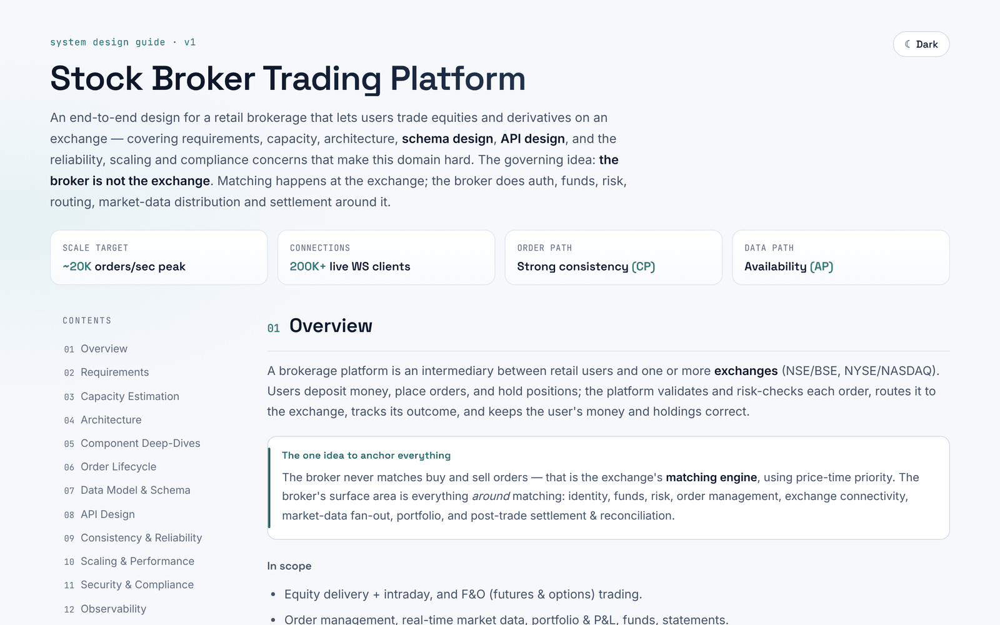
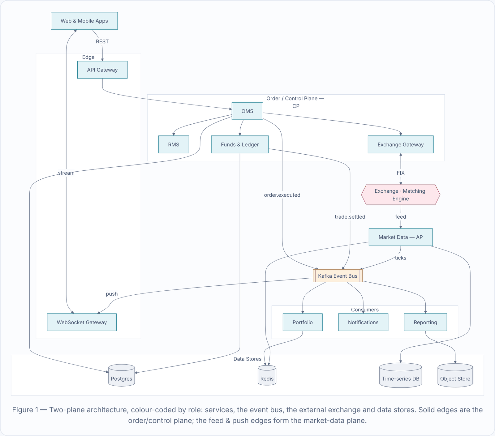
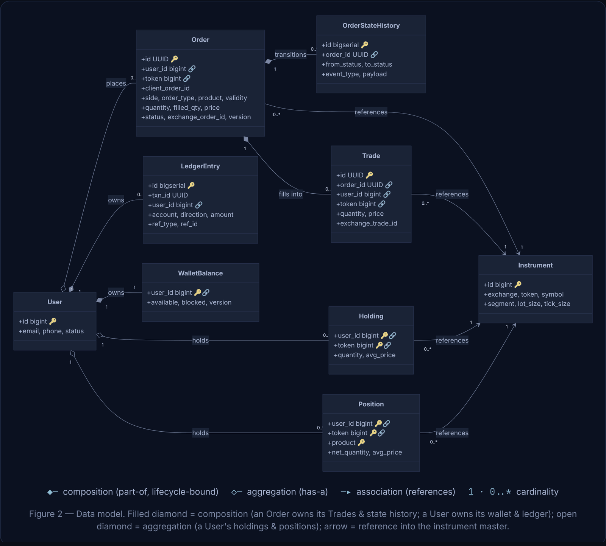
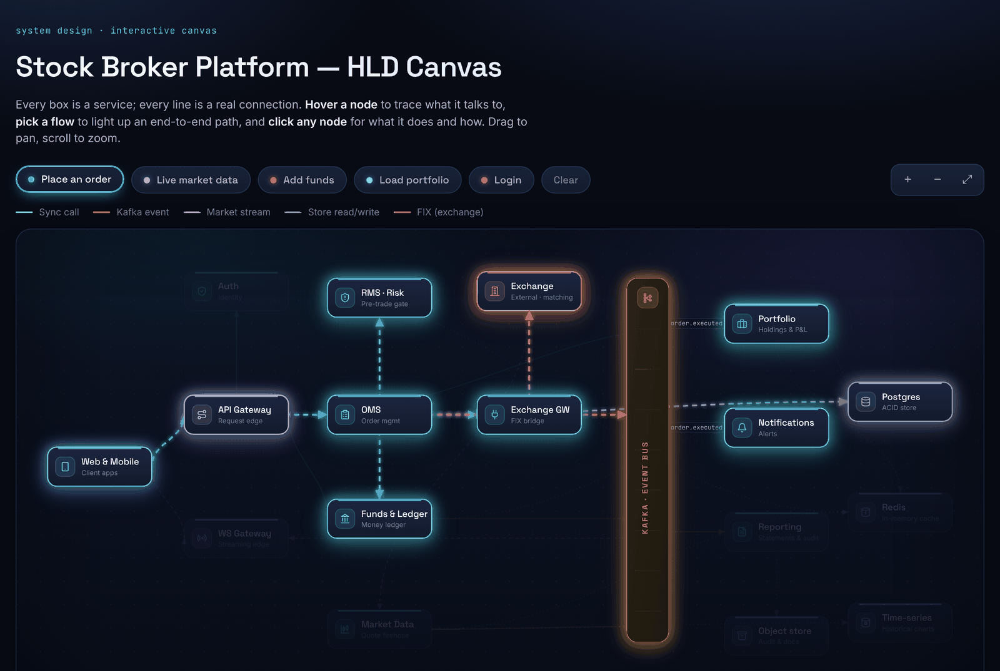
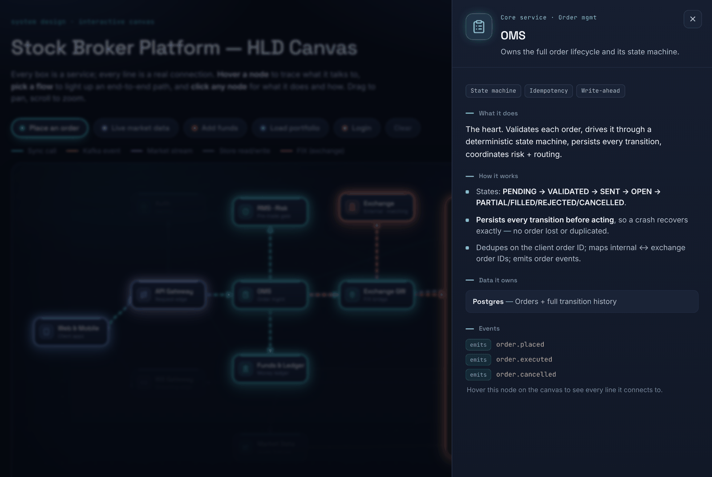
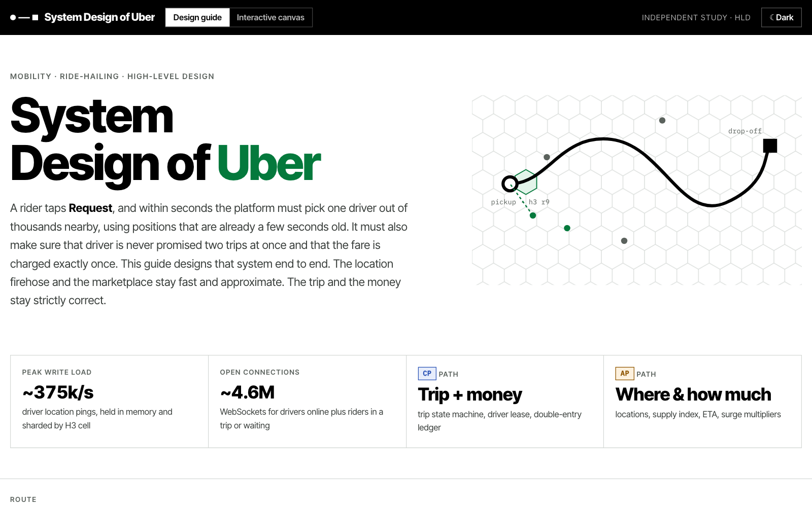
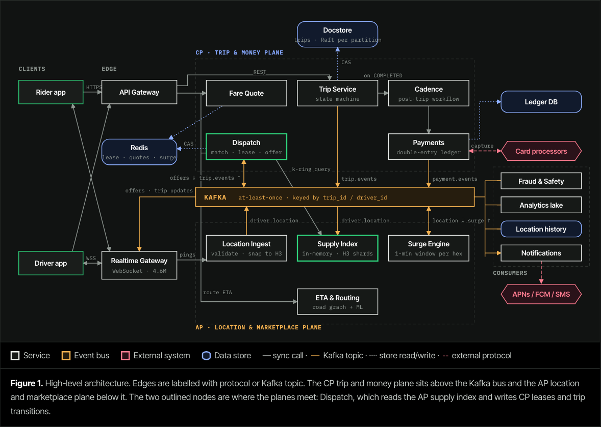
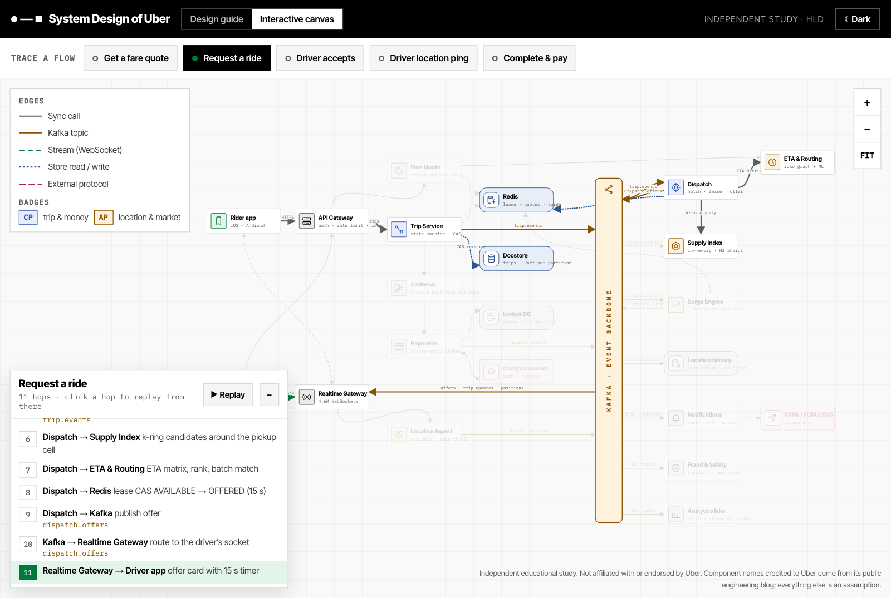

# System Design Studio

A Claude skill that turns *"design Uber"* or *"HLD for a payment gateway"* into a complete, senior-level system design guide. You get one polished page with requirements, capacity estimates, architecture and data-model diagrams, schema, APIs and trade-offs, in light and dark mode.

<picture>
  <source media="(prefers-color-scheme: dark)" srcset="docs/images/guide-dark.png">
  
</picture>

<p align="center"><sub>Example output: <a href="examples/stock-broker">Stock Broker Trading Platform</a>, generated with this skill.</sub></p>

## Contents

- [What you get](#what-you-get)
- [Installation](#installation)
- [Usage](#usage)
- [What's in a guide](#whats-in-a-guide)
- [Themes](#themes)
- [Example: stock broker platform](#example-stock-broker-platform)
- [Example: Uber (single file)](#example-uber-single-file)
- [Repository layout](#repository-layout)
- [Disclaimer](#disclaimer)
- [License](#license)

## What you get

- **A full design document, not a chat answer.** Thirteen sections, from requirements to trade-offs, with a sticky table of contents. It is published as a page you can keep and share.
- **Real diagrams.** An architecture diagram and an entity model showing composition, aggregation and association with cardinality. Both are re-coloured when the theme changes. The entity model is drawn with Mermaid; busy architecture graphs are drawn as inline SVG so they stay readable.
- **Checked numbers.** Capacity estimates show their arithmetic. Diagrams, schema, events and APIs are cross-checked to agree with each other.
- **Company-aware styling.** Ask about Uber, Netflix or WhatsApp and the page takes on that product's look and vocabulary. Generic topics use a clean default template.
- **Light and dark mode.** The page follows your system setting, and a toggle overrides it.
- **Optional interactive canvas.** A clickable node graph where you hover a service to trace its connections, light up end-to-end flows, and open a panel explaining each component.
- **Run it locally.** Ask for a single HTML file and you get the guide and the canvas in one page with tabs, ready to open in a browser or serve with `python3 -m http.server`.

| Architecture diagram | Data model |
|:---:|:---:|
|  |  |

| Interactive canvas: "Place an order" flow | Component detail panel |
|:---:|:---:|
|  |  |

## Installation

Pick the option that matches where you use Claude.

### Option 1: Claude Code plugin (recommended)

Add this repository as a plugin marketplace, then install the plugin:

```bash
claude plugin marketplace add prasoonsoni/system-design-studio
claude plugin install system-design-studio@system-design-studio
```

Or do the same from inside a Claude Code session:

```text
/plugin marketplace add prasoonsoni/system-design-studio
/plugin install system-design-studio@system-design-studio
```

To update or remove it later:

```bash
claude plugin marketplace update system-design-studio
claude plugin update system-design-studio
claude plugin uninstall system-design-studio
```

### Option 2: Claude Code, as a personal skill

Copy just the skill into your skills folder. It loads in every project.

```bash
mkdir -p ~/.claude/skills/system-design-studio
curl -fsSL https://raw.githubusercontent.com/prasoonsoni/system-design-studio/main/skills/system-design-studio/SKILL.md \
  -o ~/.claude/skills/system-design-studio/SKILL.md
```

For a single project instead, put it in that project's `.claude/skills/system-design-studio/` folder.

### Option 3: Claude apps (claude.ai, desktop, mobile)

1. Build the skill ZIP:

   ```bash
   git clone https://github.com/prasoonsoni/system-design-studio.git
   cd system-design-studio/skills
   zip -r system-design-studio.zip system-design-studio
   ```

   Without git: download [`SKILL.md`](skills/system-design-studio/SKILL.md), put it in a folder named exactly `system-design-studio`, and compress that folder to `system-design-studio.zip`. The folder name must match the skill name.

2. In Claude, open **Customize → Skills**, click **+**, choose **Create skill → Upload a skill**, and select the ZIP.
3. Make sure the skill is switched on in your skills list.

Skills need code execution enabled. On Free, Pro and Max plans, turn on **Settings → Capabilities → Create and edit files**. On Team and Enterprise plans, an owner may need to allow skills first. See [Use skills in Claude](https://support.claude.com/en/articles/12512180-use-skills-in-claude) for the current steps.

## Usage

Just ask for a system design. The skill activates on its own when the request matches.

| You ask | You get |
|---|---|
| `System design of Uber` | A guide themed after Uber's product, using its vocabulary (riders, trips, dispatch, surge), built from its public engineering blog and cited ([example](examples/uber)) |
| `Design a URL shortener` | A guide in the default template |
| `HLD for a payment gateway` | A guide in the default template, built around why the gateway never holds the funds itself |
| `Design WhatsApp and add the interactive canvas` | The guide plus a clickable architecture canvas |
| `Design Netflix, keep it plain and minimal` | Your style instead of the product theme |
| `Design Uber as one HTML file I can run on localhost` | The guide and the canvas in one page with tabs, as a local file |

To call it explicitly:

- Claude Code plugin: `/system-design-studio:system-design-studio design Uber`
- Claude Code personal skill: `/system-design-studio design Uber`

**What happens when you ask**

1. Claude decides the subject and theme: a named company gets a product-inspired theme, anything else the default.
2. For a real company, it researches public engineering sources first and marks everything else as an assumption.
3. It shares a short brainstorm: the central insight of the domain, which parts need strong consistency and which favour availability, and the hard problems.
4. It builds the page, renders it in both light and dark mode to check it, then publishes it.

**Tips**

- Name the company if you want its look and real architecture details ("system design of Swiggy", not "a food delivery app").
- Ask follow-ups on the same guide: "add a sequence diagram for checkout", "go deeper on the matching service", "export as PDF".

## What's in a guide

1. **Overview**: what the system is, the one idea that anchors the design, and the scope
2. **Requirements**: functional and non-functional (latency, availability, consistency per path, durability, scale, security, idempotency)
3. **Capacity estimation**: users, peak traffic, fan-out and storage, with the arithmetic shown
4. **Architecture**: diagram and walkthrough of each part of the system
5. **Component deep-dives**: how each core service works, the data it owns and how it fails
6. **Core flow**: the product's main end-to-end flow, step by step
7. **Data model & schema**: entity diagram, cache and storage layouts, event topics and a sample event
8. **API design**: conventions, endpoints, a worked request and response, status codes, streaming protocol
9. **Consistency & reliability**: guarantees per path, sagas, idempotency, failure scenarios
10. **Scaling & performance**
11. **Security & compliance**
12. **Observability**
13. **Trade-offs**: each key decision and why, ending with "if you remember five things"

## Themes

**Default template.** Used for generic systems: a midnight dark mode and a cool light mode, with Space Grotesk, Inter and JetBrains Mono.

**Product-inspired themes.** Used when you name a company. The skill includes starting points for Uber, Netflix, WhatsApp, Airbnb, Spotify, Stripe, Swiggy/Zomato and Zerodha, and works out others the same way, from the product's colours, type, shapes and one signature motif. Themes are *inspired by* the product, not copied: no logos, wordmarks, screenshots or proprietary fonts, and every page carries a "not affiliated" footer.

Every theme defines both modes. All colours come from CSS variables, so the page, code blocks and diagrams switch together.

## Example: stock broker platform

[`examples/stock-broker/`](examples/stock-broker) contains a complete design for a retail stock-broking platform: order management, risk checks, FIX connectivity to the exchange, market-data fan-out and a double-entry ledger.

| File | What it is |
|---|---|
| [`system-design-guide.html`](examples/stock-broker/system-design-guide.html) | The full guide, light and dark |
| [`hld-canvas.html`](examples/stock-broker/hld-canvas.html) | Interactive architecture canvas |
| [`hld-explorer.html`](examples/stock-broker/hld-explorer.html) | Layered explorer with a step-through order lifecycle |

GitHub shows HTML files as source, so download the folder (or clone the repo) and open the files in a browser. An internet connection is needed for the fonts and diagrams.

## Example: Uber (single file)

[`examples/uber/`](examples/uber) is a product-themed design of an Uber-scale ride-hailing platform: H3-sharded supply index, dispatch with a per-driver offer lease, trip state machine, surge per hexagon, and payments through a durable workflow into a double-entry ledger. The guide and the interactive canvas ship as **one HTML file** with tabs.

<picture>
  <source media="(prefers-color-scheme: dark)" srcset="docs/images/uber-guide-dark.png">
  
</picture>

| Architecture (hand-drawn SVG) | Canvas: "Request a ride" flow |
|:---:|:---:|
|  |  |

```bash
cd examples/uber
python3 -m http.server 8765
# open http://localhost:8765/system-design-guide.html  (add #canvas for the canvas tab)
```

## Repository layout

```text
system-design-studio/
├── .claude-plugin/
│   ├── marketplace.json        # lets Claude Code add this repo as a marketplace
│   └── plugin.json             # plugin manifest
├── skills/
│   └── system-design-studio/
│       └── SKILL.md            # the skill itself
├── examples/
│   ├── stock-broker/           # guide, canvas and explorer as separate pages
│   └── uber/                   # product-themed guide + canvas in one file
└── docs/
    └── images/                 # screenshots used in this README
```

## Disclaimer

Guides about real companies are independent educational studies. They are not affiliated with or endorsed by those companies, and their architectures are reconstructed from public sources and stated assumptions. Capacity numbers are order-of-magnitude estimates for design discussions, not production figures.

## License

[MIT](LICENSE) © Prasoon Soni
